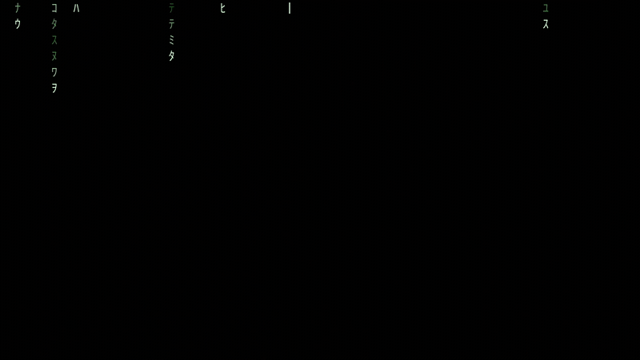
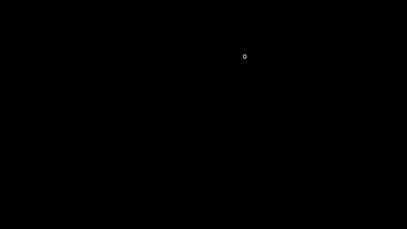

# Omasaver

**Omasaver** is a personalization plugin and CLI tool for [Omarchy](https://omarchy.com) that lets you replace the default idle screensaver logo with your own custom text, rendered in Omarchy's signature 8-row block typography, and preview it with 24 animated effects.

<p align="center">
  
</p>
<p align="center"><em>Personalized screensaver ("NIHAL") in official 8-row block typography with Matrix digital rain</em></p>

<p align="center">
  
</p>
<p align="center"><em>Official OMARCHY logo animated with the Fireworks particle effect</em></p>

---

## Table of Contents

- [Features](#features)
- [Screenshots](#screenshots)
- [Prerequisites](#prerequisites)
- [Installation](#installation)
  - [One-Command Install (Recommended)](#one-command-install-recommended)
  - [Via Omarchy Plugin Store UI](#via-omarchy-plugin-store-ui)
  - [Manual / Local Install](#manual--local-install)
- [Uninstallation](#uninstallation)
- [Usage](#usage)
  - [Shell Bar Panel (GUI)](#shell-bar-panel-gui)
  - [Command Line (CLI)](#command-line-cli)
- [Animation Effects](#animation-effects)
- [Typography](#typography)
- [Configuration](#configuration)
- [Project Structure](#project-structure)
- [Troubleshooting](#troubleshooting)
- [License](#license)

---

## Features

- **Custom Text Engine** — Renders any word (up to 7 characters) in Omarchy's official 8-row curved block font with uniform 2-space kerning, exactly matching the default `OMARCHY` logo typography.
- **24 Animation Effects** — Powered by [`ttfx`](https://github.com/ChrisBuilds/terminaltexteffects), including Matrix rain, Decryption, Fireworks, Black Hole, Laser Etch, and more.
- **Shell Bar Widget** — A clickable icon in the Omarchy top bar that opens a popup panel with live ASCII art preview, text input, effect selector, and action buttons.
- **Test Drive** — Preview any animation in full screen (with top bar hidden) at the official screensaver font size (18pt) and 120 FPS before committing.
- **Full Screen Launch** — Trigger the full-screen screensaver directly from the panel.
- **One-Click Reset** — Revert to the stock Omarchy logo with a desktop notification.
- **Supports A–Z, 0–9, and symbols** — Full uppercase alphabet, digits, and special characters (`-`, `!`, `.`, space).

---

## Screenshots

| Shell Bar Panel | Live ASCII Preview | Test Drive (Matrix) |
|---|---|---|
| Popup panel with text input, effect selector, and action buttons | Real-time 8-row block font preview as you type | Floating terminal window running the matrix effect |

---

## Prerequisites

Omasaver runs on **Omarchy Linux** and depends on the following packages that ship with a standard Omarchy installation:

| Dependency | Purpose | Included in Omarchy |
|---|---|---|
| **Omarchy** (base system) | Screensaver, shell, Hyprland, Quickshell | ✅ Yes |
| **bash** ≥ 5.0 | CLI script runtime | ✅ Yes |
| **python3** ≥ 3.10 | Glyph rendering engine in `omasaver set` | ✅ Yes |
| **ttfx** (`terminaltexteffects`) | Terminal animation effects engine | ✅ Yes |
| **foot** | Terminal emulator for Test Drive window | ✅ Yes |
| **hyprctl** | Hyprland IPC for fullscreen dispatch and input detection | ✅ Yes |
| **Quickshell** | Omarchy shell framework (runs QML plugins) | ✅ Yes |
| **jq** | JSON processing for status checks | ✅ Yes |

> [!NOTE]
> All dependencies are part of the default Omarchy installation. No additional packages need to be installed.

### Optional

| Dependency | Purpose |
|---|---|
| **omarchy-notification-send** | Desktop notifications on reset (falls back to `notify-send`) |
| **git** | Only needed if you want to contribute or clone from GitHub |

---

## Installation

### One-Command Install (Recommended)

You can install and enable Omasaver directly using Omarchy's built-in plugin manager:

```bash
omarchy plugin add https://github.com/Shaik-Nihal/omasaver.git --enable
```

**That's it!** Omarchy will automatically:
1. Clone the repository into `~/.config/omarchy/plugins/nihal.omasaver`.
2. Validate the manifest schema.
3. Activate the **󱄄** widget in your top bar.
4. Auto-symlink `omasaver` to `~/.local/bin/omasaver` on launch so the CLI is immediately available in your terminal.

---

### Via Omarchy Plugin Store UI

Once listed in the Omarchy Community Catalog, you can also install it directly with a single click:
1. Open the Omarchy Menu (`Super` or click the menu button).
2. Navigate to **Plugins** → **Install Plugins**.
3. Select **Omasaver** (`nihal.omasaver`) and click **Enable**.

---

### Manual / Local Install

If installing from a downloaded copy of this repository instead of `omarchy plugin add`:

```bash
# 1. Copy the plugin folder into your Omarchy plugins directory
cp -r /path/to/omasaver ~/.config/omarchy/plugins/nihal.omasaver

# 2. Reload the Omarchy shell to activate the plugin
/usr/share/omarchy/bin/omarchy-restart-shell
```

To update an existing installation added via `omarchy plugin add`:

```bash
omarchy plugin update nihal.omasaver
```

The plugin automatically detects its directory and symlinks `bin/omasaver` to `~/.local/bin/omasaver` on first run. If you wish to manually link it yourself:

```bash
mkdir -p ~/.local/bin
ln -sf ~/.config/omarchy/plugins/nihal.omasaver/bin/omasaver ~/.local/bin/omasaver
```

---

## Uninstallation

### One-Command Removal (Recommended)

```bash
omarchy plugin remove nihal.omasaver
```

To also remove the terminal CLI symlink and custom screensaver text:

```bash
rm -f ~/.local/bin/omasaver
rm -f ~/.config/omarchy/branding/screensaver.txt
```

---

### Manual Removal

```bash
# 1. Remove the shell plugin
rm -rf ~/.config/omarchy/plugins/nihal.omasaver

# 2. Remove the CLI tool
rm -f ~/.local/bin/omasaver

# 3. (Optional) Remove custom screensaver branding to restore default
rm -f ~/.config/omarchy/branding/screensaver.txt

# 4. Reload the shell
/usr/share/omarchy/bin/omarchy-restart-shell
```

### Remove CLI Only

```bash
rm -f ~/.local/bin/omasaver
```

### Remove Plugin Only (keep CLI)

```bash
rm -rf ~/.config/omarchy/plugins/nihal.omasaver
/usr/share/omarchy/bin/omarchy-restart-shell
```

---

## Usage

### Shell Bar Panel (GUI)

1. **Click the 󱄄 icon** in the Omarchy top bar to open the Omasaver panel.
2. **Type your text** (1–7 characters) in the input field. A live ASCII art preview updates as you type.
3. **Select an animation effect** from the dropdown menu.
4. **Click Apply** to save your custom screensaver text.
5. Use the action buttons:

| Button | Action |
|---|---|
| **󰐥 Test Drive** | Launches full-screen preview of the selected animation effect (top bar hidden). Press any key or move mouse to exit. |
| **󰁯 Reset** | Reverts to the default Omarchy logo and shows a desktop notification. |
| **󱄄 Full Screen** | Closes the panel and launches the full-screen screensaver immediately. |

**Right-click** the bar icon to launch the screensaver instantly without opening the panel.

### Command Line (CLI)

```bash
# Set custom screensaver text (1–7 uppercase characters)
omasaver set "NIHAL"
omasaver set "HELLO"
omasaver set "2025"

# Preview an animation effect in full screen
omasaver test matrix
omasaver test fireworks
omasaver test decrypt
omasaver test blackhole

# List all 24 available animation effects
omasaver list

# View current screensaver status and preview
omasaver status

# Launch the full-screen screensaver
omasaver run

# Revert to the default Omarchy logo
omasaver reset

# Show help
omasaver help
```

---

## Animation Effects

Omasaver supports all 24 `ttfx` animation effects:

| Effect | Description |
|---|---|
| `matrix` | Matrix digital rain code |
| `decrypt` | Movie-style decryption scramble |
| `fireworks` | Exploding colorful fireworks |
| `rain` | Falling rain drops settling into place |
| `beams` | Sweeping searchlight beams |
| `bubbles` | Floating soap bubbles that pop |
| `burn` | Vertical flame wall burning down |
| `laseretch` | High-precision laser engraving |
| `scattered` | Flying scattered characters |
| `crumble` | Crumbling dust and reformation |
| `blackhole` | Singularity collapse and outward burst |
| `bouncyballs` | Bouncing rubber balls |
| `colorshift` | Chromatic RGB gradient shift |
| `slice` | Horizontal sliding slices |
| `rings` | Orbital spinning rings |
| `overflow` | Buffer overflow rolling glitch |
| `orbittingvolley` | Orbiting corner turret volleys |
| `pour` | Liquid characters pouring from above |
| `binarypath` | Streaming binary 0s and 1s |
| `errorcorrect` | Glitch repair in sequence |
| `expand` | Explosion outward from center |
| `middleout` | Expansion from center row and column |
| `print` | Mechanical vintage typewriter |
| `highlight` | Specular light gleam |

You can also use `random` to cycle through effects randomly:

```bash
omasaver test random
```

---

## Typography

Omasaver uses Omarchy's official 8-row curved block typography, derived directly from `/usr/share/omarchy/logo.txt` (Copyright © 2024–2026 David Heinemeier Hansson, used under the MIT License):

- **Glyph grid**: 9 columns × 8 rows for standard letters (A–Z except M and W)
- **Wide glyphs**: M and W are 15 columns × 8 rows (3-pillar design)
- **Kerning**: Uniform 2-space gap between all glyphs, matching the official `OMARCHY` logo spacing
- **Character set**: A–Z, 0–9, space, hyphen (`-`), exclamation (`!`), period (`.`)
- **Max length**: 7 characters (enforced in both CLI and GUI to fit within screen boundaries)

Example rendering of `NIHAL`:

```
 ▄█   █▄   ▄███████  ▄█   █▄    ▄███████  ▄█
███   ███  ▀▀▀███▀▀▀ ███   ███  ███   ███  ███
████  ███     ███    ███   ███  ███   ███  ███
█████ ███     ███    ███▄▄▄███  ███▄▄▄███  ███
███ █████     ███    ███▀▀▀███  ███▀▀▀███  ███
███  ████     ███    ███   ███  ███   ███  ███   ▄█
███   ███  ▄▄▄███▄▄▄ ███   ███  ███   ███  ███▄▄▄██
 ▀█   █▀   ▀███████▀  ▀█   █▀   ███   █▀   ▀██████▀
```

---

## Configuration

### File Locations

| Path | Description |
|---|---|
| `~/.config/omarchy/branding/screensaver.txt` | Active screensaver text file (created by `omasaver set`) |
| `~/.config/omarchy/plugins/nihal.omasaver/` | Installed plugin directory |
| `~/.local/bin/omasaver` | CLI binary |
| `/usr/share/omarchy/logo.txt` | Default Omarchy logo (read-only, system file) |
| `/usr/share/omarchy/default/foot/screensaver.ini` | Screensaver terminal config (font size 18, black background) |

### How It Works

1. `omasaver set "TEXT"` renders the text using the embedded Python glyph engine and writes the result to `~/.config/omarchy/branding/screensaver.txt`.
2. The Omarchy screensaver reads this file on each activation. If the file does not exist, it falls back to the default logo at `/usr/share/omarchy/logo.txt`.
3. `omasaver reset` copies the default logo back to the branding file, restoring factory behavior.
4. `omasaver test <effect>` generates a temporary runner script, launches `foot` terminal with `--app-id=omasaver.fullscreen --fullscreen` covering the entire screen (with the top bar hidden), and runs `ttfx` in a continuous loop until any key is pressed or the mouse is moved.

---

## Project Structure

```
omasaver/
├── manifest.json       # Omarchy shell plugin manifest (schemaVersion 1)
├── BarWidget.qml       # Top bar icon with left-click toggle and right-click launch
├── Panel.qml           # Popup panel: text input, live preview, effect selector, actions
├── Model.js            # 8-row glyph dictionary and ASCII art rendering engine (QML)
├── README.md           # This file
├── bin/
│   └── omasaver        # Standalone bash CLI tool (no QML dependency)
├── assets/
│   └── icon.svg        # Plugin icon
└── i18n/
    └── en.json         # English language strings
```

### Key Files Explained

| File | Role |
|---|---|
| **manifest.json** | Declares the plugin ID (`nihal.omasaver`), version, entry points, and bar widget metadata. Follows Omarchy's schemaVersion 1 plugin format. |
| **BarWidget.qml** | Minimal bar icon that loads `Panel.qml` and handles left-click (toggle panel) and right-click (launch screensaver). |
| **Panel.qml** | Full popup interface: text input with 7-char limit and live counter, monospace ASCII art preview, animation effect dropdown (24 effects), and three action buttons (Test Drive, Reset, Full Screen). |
| **Model.js** | Contains the complete A–Z + 0–9 glyph dictionary in 8-row block format and the `generateAscii()` function used by the QML preview. |
| **bin/omasaver** | Self-contained bash script with an embedded Python glyph renderer. Handles `set`, `reset`, `test`, `run`, `list`, `status`, and `help` subcommands. |

---

## Troubleshooting

### The bar icon doesn't appear after installation

```bash
# Make sure the plugin is in the correct directory
ls ~/.config/omarchy/plugins/nihal.omasaver/manifest.json

# Restart the shell
/usr/share/omarchy/bin/omarchy-restart-shell
```

### `omasaver: command not found`

```bash
# Verify the CLI is installed and executable
ls -la ~/.local/bin/omasaver

# Check your PATH includes ~/.local/bin
echo $PATH | tr ':' '\n' | grep .local/bin
```

### Test Drive shows errors or doesn't open

- Ensure `ttfx` is installed: `which ttfx`
- Ensure `foot` terminal is installed: `which foot`
- Check that Hyprland is running: `echo $HYPRLAND_INSTANCE_SIGNATURE`

### Full Screen screensaver exits immediately

The screensaver requires window focus. If the Omasaver panel is still open when it launches, it will lose focus and exit. The panel now auto-closes before launching — if you still see this, restart the shell:

```bash
/usr/share/omarchy/bin/omarchy-restart-shell
```

### Preview fonts look wrong in the panel

After editing `Model.js` or `Panel.qml`, Quickshell caches imported modules. You must restart the shell for changes to take effect:

```bash
/usr/share/omarchy/bin/omarchy-restart-shell
```

---

## License

MIT License — Copyright (c) 2026 [Shaik Nihal](https://github.com/Shaik-Nihal)  
Portions Copyright (c) 2024–2026 David Heinemeier Hansson (Omarchy original logo typography, used under the MIT License).
